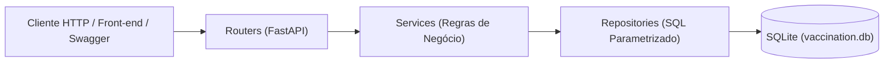

# Arquitetura do Sistema — API de Pontos de Vacinação (Alagoas)

## 1. Visão Geral

Esta API REST somente leitura fornece consulta aos **102 municípios** do estado de Alagoas e às **895 Unidades Básicas de Saúde (UBSs)** ativas no SUS registradas no CNES. O sistema foi projetado para ser simples, determinístico, facilmente auditável e hospedável em infraestrutura gratuita com disco efêmero.



---

## 2. Estrutura de Pastas e Regra de Dependência

```text
.
├── app/
│   ├── main.py              # Instância FastAPI, CORS, handlers globais e /health
│   ├── database.py          # Resolução de DB_PATH e dependência get_db()
│   ├── errors.py            # Exceções de domínio e envelope único JSON de erro
│   ├── routers/             # Camada HTTP: valida parâmetros e delega ao service
│   ├── services/            # Camada de negócio: regras, validações e mapeamento
│   ├── repositories/        # Camada de dados: único ponto com SQL (parametrizado)
│   └── schemas/             # Modelos Pydantic (contratos de serialização JSON)
├── data/                    # CSVs versionados (IBGE + CNES) e README de fontes
├── scripts/
│   ├── fetch_data.py        # Coleta reproduzível das APIs públicas (IBGE e CNES)
│   └── seed.py              # Recriação idempotente do SQLite a partir dos CSVs
├── tests/                   # Suíte pytest com SQLite temporário isolado
└── docs/
    └── architecture.md
```

**Regra de dependência:** `routers → services → repositories → database`.
- `routers` nunca executam SQL nem conhecem `sqlite3` (apenas recebem a conexão via `Depends(get_db)` e repassam ao `service`).
- `services` concentram regras de domínio (ex.: lançar `CityNotFoundError` quando a cidade não existe) e não conhecem objetos HTTP (`Request`/`JSONResponse`).
- `repositories` executam exclusivamente consultas SQL parametrizadas (`?`) e retornam registros brutos (`sqlite3.Row`).

---

## 3. Decisões Arquiteturais (Contexto → Decisão → Justificativa → Trade-offs)

### 3.1. Estilo Cliente–Servidor
- **Contexto:** Os dados públicos de municípios (IBGE) e estabelecimentos (CNES) precisam ser consumidos por clientes web, mobile ou ferramentas de teste sem acoplar interface e armazenamento.
- **Decisão:** Expor uma API HTTP stateless desacoplada de qualquer interface visual, com suporte a CORS.
- **Justificativa:** Permite evolução independente do cliente e reutilização dos mesmos dados por múltiplas aplicações.
- **Consequências / Trade-offs:** Exige definição clara de contrato (OpenAPI/JSON) e tratamento explícito de erros HTTP.

### 3.2. Padrão REST sobre HTTP + JSON
- **Contexto:** O sistema oferece consulta pública e somente leitura sobre entidades bem definidas.
- **Decisão:** Adotar REST com recursos orientados a substantivos (`/cities`, `/vaccination-points/{cityId}`), método exclusivamente `GET`, códigos de status semânticos (`200`, `400`, `404`, `500`) e payload JSON.
- **Justificativa:** Baixa barreira de integração, cacheabilidade natural de respostas `GET` e documentação automática via OpenAPI (`/docs`).
- **Consequências / Trade-offs:** Consultas muito específicas exigiriam novos parâmetros de filtro no futuro, mas atendem integralmente ao escopo atual.

### 3.3. Arquitetura em Camadas
- **Contexto:** Mesmo em APIs pequenas, misturar rotas HTTP, regras de validação e SQL em um único arquivo dificulta testes e manutenção.
- **Decisão:** Separar o código em `routers`, `services`, `repositories` e `schemas`.
- **Justificativa:** Isola responsabilidades, facilita testes unitários/integrados com banco temporário e torna o código legível para avaliação acadêmica e evolução por uma equipe de 2 pessoas.
- **Consequências / Trade-offs:** Gera um número um pouco maior de arquivos iniciais, compensado pela clareza e manutenibilidade.

### 3.4. Padrão Repository
- **Contexto:** O projeto utiliza `sqlite3` da biblioteca padrão, mas pode evoluir para PostgreSQL no futuro.
- **Decisão:** Encapsular todas as queries SQL em `app/repositories/`.
- **Justificativa:** Trocar o SGBD ou adotar um ORM impacta apenas a camada de repositório, preservando `services` e `routers`.
- **Consequências / Trade-offs:** Exige disciplina para não vazar `sqlite3.Row` diretamente para a resposta HTTP sem passar por `service`/`schema`.

### 3.5. Monolito
- **Contexto:** Equipe de 2 pessoas, escopo restrito ao estado de Alagoas e operação exclusivamente de leitura.
- **Decisão:** Implantar toda a aplicação em um único serviço FastAPI.
- **Justificativa:** Microsserviços introduziriam latência de rede, orquestração e sobrecarga operacional sem ganho real para o volume e tamanho da equipe.
- **Consequências / Trade-offs:** Escalabilidade é vertical/por réplica do processo único, suficiente para a carga esperada.

### 3.6. MVC vs. Arquitetura em Camadas em APIs JSON
- **Contexto:** Sistemas web tradicionais usam MVC (Model–View–Controller) para renderizar páginas HTML.
- **Decisão:** Adotar Arquitetura em Camadas com modelos Pydantic no lugar de uma camada "View".
- **Justificativa:** Em uma API REST JSON, não há renderização de templates HTML; o papel da "View" é cumprido pela serialização de contratos (`app/schemas/`), enquanto o "Controller" corresponde aos `routers` e o "Model" se divide entre `services`, `repositories` e `schemas`.
- **Consequências / Trade-offs:** Alinha a nomenclatura ao ecossistema moderno de APIs Python/FastAPI.

### 3.7. SQLite + Seed Versionado em CSV
- **Contexto:** O plano gratuito do Render utiliza disco efêmero (arquivos gravados em runtime são perdidos entre deploys/restarts).
- **Decisão:** Versionar os dados tratados em `data/cities.csv` e `data/vaccination_points.csv` no Git e recriar o banco `vaccination.db` a cada deploy via `scripts/seed.py`.
- **Justificativa:** Elimina dependência de banco gerenciado externo, garante deploy 100% reproduzível e mantém latência mínima de leitura em disco local.
- **Consequências / Trade-offs:** Não suporta escrita concorrente em produção, o que é aceitável porque a API é estritamente somente leitura.

---

## 4. Hierarquia de Recursos (Domínio)

O modelo reflete a hierarquia geográfica do domínio:
1. **Estado (Alagoas — UF 27):** escopo implícito da aplicação (`state: "AL"` no detalhe da cidade).
2. **Cidade (`/cities` e `/cities/{id}`):** representa os 102 municípios oficiais do IBGE, agregando `vaccination_points_count`.
3. **Ponto de Vacinação (`/vaccination-points/{cityId}`):** unidades básicas de saúde vinculadas a uma cidade via `city_id` (chave estrangeira indexada por `idx_points_city`).

---

## 5. Tratamento de Erros e Status Codes

Todas as respostas de erro seguem o envelope único definido em `app/errors.py`:

```json
{
  "error": {
    "code": "CODIGO_DE_ERRO",
    "message": "Mensagem descritiva em português."
  }
}
```

| Situação | Status HTTP | Código (`error.code`) | Origem |
| :--- | :---: | :--- | :--- |
| Sucesso na consulta (inclusive lista `[]` quando cidade existe sem pontos) | `200` | — | Routers / Services |
| Identificador não numérico, zero ou negativo (`gt=0`) | `400` | `INVALID_ID` | Handler de `RequestValidationError` (substitui o `422` padrão do FastAPI) |
| Cidade inexistente no banco | `404` | `CITY_NOT_FOUND` | Handler de `CityNotFoundError` |
| Erro inesperado no servidor | `500` | `INTERNAL_ERROR` | Handler global de `Exception` (sem expor *stack trace*) |

---

## 6. Refinamentos em Relação ao Plano Inicial

- **`DB_PATH` centralizado (`app/database.py`):** permite apontar o SQLite via variável de ambiente em produção e usar `app.dependency_overrides` com `tmp_path` nos testes.
- **Validação `Path(..., gt=0)` e handler `500`:** garante que IDs `<= 0` retornem `400 INVALID_ID` e que falhas inesperadas sempre respondam em JSON.
- **Paginação por índice de página no CNES (`scripts/fetch_data.py`):** a API Dados Abertos do CNES utiliza `offset` como número de página (20 itens/página), permitindo coletar todas as 895 UBSs ativas de Alagoas.
